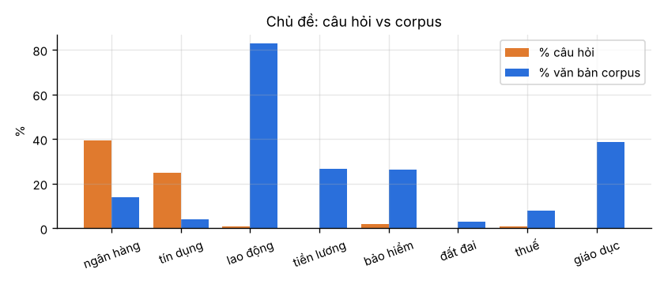
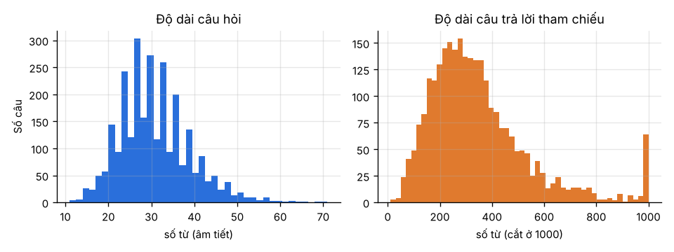

# Báo cáo: Cải tiến hệ thống RAG cho chatbot hỏi đáp pháp luật

> **Bản nháp.** Các mục có ⏳ cần số liệu từ phần chạy GPU (`notebooks/run_on_kaggle.ipynb`).
> Mọi số liệu khác được sinh bởi các script trong `scripts/` và chạy lại được (xem `README.md`).

## 1. Giới thiệu
Mục tiêu là cải thiện các chỉ số Cosine, Jaccard, Token Overlap, BLEU và ROUGE-L so với baseline RAG được cung cấp
(sbert + FAISS + Qwen1.5-1.8B). LLM phải có dưới 4B tham số. Đánh giá trên **200 cặp QA cố định** (yêu cầu tối thiểu là 100).

## 2. Khám phá dữ liệu
*Chi tiết và hình: `results/eda/eda_summary.md`.*

**Corpus.** 16.439 văn bản, khoảng 268 triệu ký tự sau khi làm sạch. Trung vị khoảng 9.000 ký tự mỗi văn bản, p95 khoảng 52.000.
Phần lớn là Quyết định (9.090), Thông tư (1.835), Nghị quyết (1.828) và Kế hoạch (1.317). Cơ quan ban hành chủ yếu là UBND/HĐND các tỉnh.
Mỗi file kết thúc bằng 3 khối do crawler thêm vào: *THÔNG TIN THÊM* (tên, số hiệu, loại, **lĩnh vực**, nơi ban hành, ngày, tình trạng hiệu lực),
*MỤC LỤC* và *VĂN BẢN LIÊN QUAN*. **100% văn bản thuộc lĩnh vực "Lao động – Tiền lương".**
Chỉ khoảng 47% văn bản còn hiệu lực. Văn bản bị ngắt dòng cứng giữa câu (ví dụ "VIỆT\n NAM").

**Bộ câu hỏi RES.** 2.745 cặp QA. Câu hỏi trung bình 31 từ. Câu trả lời tham chiếu **trung bình 351 từ** (p95 740 từ).
55% câu trả lời mở đầu bằng "Căn cứ…" và 92% có nhắc "Điều N". 772 câu (28%) không có số hiệu văn bản.
Văn bản được hỏi chủ yếu là của **NHNN (ngân hàng)** (1.256 câu) và Nghị định CP (444 câu).

**Độ phủ.** Chỉ **8/314** văn bản được hỏi có trong corpus, ứng với **51/2.745 câu (1,9%)**.
Từ "ngân hàng" có trong 39% câu hỏi nhưng chỉ ở 15% văn bản, còn "lao động" có trong 0,9% câu hỏi nhưng ở 98,5% văn bản.
→ Với khoảng 98% câu hỏi, không cấu hình retrieval nào lấy được văn bản nguồn.
Vì vậy kết quả được báo cáo riêng cho hai nhóm **covered** và **not_covered**.

## 3. Baseline
Baseline gồm: chunk 2000/50 ký tự trên văn bản đã chuyển hết sang chữ thường → `keepitreal/vietnamese-sbert` → FAISS top-5 →
prompt ngắn → `Qwen/Qwen1.5-1.8B` (bản base), greedy, `max_new_tokens=256`.

Hai điểm cần lưu ý khi tái lập:
1. Notebook gốc chỉ chạy `df.head(30)`. Chúng tôi chạy lại baseline trên đúng 200 câu của tập eval.
2. `HuggingFacePipeline.generate` mặc định `skip_prompt=False`, còn transformers mặc định `return_full_text=True`.
   Vì vậy **chuỗi được chấm điểm có lẫn cả prompt và 5 chunk ngữ cảnh** (khoảng 10.000 ký tự).
   Điều này làm Token Overlap cao giả tạo. Chúng tôi báo cáo cả hai phiên bản: `baseline` (giữ nguyên hành vi gốc) và `baseline_noecho`.

## 4. Phương pháp cải tiến
| # | Thành phần | Baseline | Cải tiến | File |
|---|---|---|---|---|
| 1 | Tiền xử lý | lowercase, `\n`→space | NFC, nối dòng bị ngắt, **giữ hoa/thường**, tách metadata, **bỏ MỤC LỤC/VĂN BẢN LIÊN QUAN** | `src/legal_text.py` |
| 2 | Chunking | ký tự 2000/50 | **theo Chương/Điều**, 1000/150, cắt ở biên câu/từ, gắn **header** (loại + số hiệu + tên + Điều) vào mỗi chunk | `src/chunking.py` |
| 3 | Retrieval | dense sbert | **BM25** (âm tiết + bigram) + dense (`vietnamese-bi-encoder`) ghép bằng **RRF**, tăng hạng khi câu hỏi ghi số hiệu, tối đa 3 chunk mỗi văn bản | `src/retrieval.py`, `src/retriever.py` |
| 4 | Reranking | không có | cross-encoder `bge-reranker-v2-m3`, lấy top-20 rồi giữ top-5 | `src/dense.py` |
| 5 | LLM | Qwen1.5-1.8B (base) | **Qwen2.5-3B-Instruct** dùng chat template, greedy, `repetition_penalty=1.1`, `max_new_tokens=640` | `src/llm.py` |
| 6 | Prompt | 3 dòng chung chung | vai luật sư; **mẫu "Căn cứ tại Điều … quy định:"** giống câu trả lời tham chiếu; nguồn được đánh số kèm header và tình trạng hiệu lực; cấm bịa số hiệu; có ví dụ few-shot | `src/prompts.py` |
| 7 | Hậu xử lý | không có | bỏ prompt bị lặp, token đặc biệt và câu lặp | `src/postprocess.py` |

Lý do chọn từng thành phần:
- (2) Chunk nhỏ, có header giúp mỗi đoạn tự đứng được và cho phép đưa nhiều nguồn hơn vào context của model 3B.
- (6) Câu trả lời tham chiếu dài khoảng 350 từ và theo mẫu cố định. Metric đo độ trùng từ, nên **dạng và độ dài** câu trả lời ảnh hưởng trực tiếp tới điểm
  (BLEU có brevity penalty, Token Overlap tính trên số từ của câu tham chiếu).

## 5. Thí nghiệm

### 5.1 Retrieval (chạy trên CPU, không có LLM)
Chỉ số `DocRecall@k`/`MRR` tính trên 51 câu covered. `CtxTokenRecall` là tỷ lệ từ của câu trả lời tham chiếu xuất hiện trong ngữ cảnh lấy về.

| Cấu hình | k | DocRecall@k | MRR | CtxTokenRecall | Ký tự ngữ cảnh |
|---|---|---|---|---|---|
| BM25, chunk baseline 2000 | 5 | 0,784 | 0,606 | 0,753 | 9.739 |
| BM25, chunk theo Điều 1000 | 5 | 0,784 | 0,606 | 0,633 | 4.059 |
| BM25, chunk theo Điều 1000 | 10 | **0,824** | **0,611** | 0,732 | 7.910 |
| ⏳ dense sbert (baseline thật) | 5 | | | | |
| ⏳ dense bi-encoder | 5 | | | | |
| ⏳ hybrid (RRF) | 5 | | | | |
| ⏳ hybrid + rerank | 5 | | | | |

Với lượng ngữ cảnh tương đương (khoảng 8–10k ký tự), chunk theo Điều tìm được văn bản nguồn tốt hơn (0,824 so với 0,784),
còn CtxTokenRecall tương đương.

### 5.2 Mốc tham chiếu không dùng LLM
Ở đây câu trả lời chỉ là ghép các chunk tìm được, cắt còn 2000 ký tự. Mục đích là kiểm tra pipeline và có một mốc dưới để so sánh.

| Cấu hình | Jaccard | Token Overlap | BLEU | ROUGE-L |
|---|---|---|---|---|
| BM25, chunk baseline | 0,251 | 0,397 | 0,282 | 0,179 |
| BM25, chunk theo Điều | **0,280** | **0,431** | **0,306** | **0,204** |

### 5.3 ⏳ Kết quả chính, 200 câu (ablation)
| Cấu hình | Cosine | Jaccard | Token Overlap | BLEU | ROUGE-L |
|---|---|---|---|---|---|
| baseline (gốc, lẫn prompt) | | | | | |
| baseline_noecho | | | | | |
| A: + LLM instruct + prompt mới | | | | | |
| B: + chunk theo Điều + BM25 | | | | | |
| C: + hybrid | | | | | |
| D: + rerank | | | | | |
| E: + few-shot | | | | | |

Kèm theo: bảng theo nhóm covered/not_covered (`results/metrics/summary.csv`), thời gian mỗi câu (`sec_per_q`) và VRAM.

### 5.4 ⏳ Phân tích lỗi
Chọn 3 ví dụ tốt và 3 ví dụ xấu cho mỗi nhóm. Kiểm tra mô hình có bịa số hiệu văn bản ở nhóm not_covered hay không.

## 6. Hạn chế
- Corpus chỉ có văn bản lao động – tiền lương, trong khi câu hỏi chủ yếu về ngân hàng, nên RAG không thể trả lời đúng nội dung cho phần lớn câu hỏi.
  Phần điểm tăng trên nhóm not_covered chủ yếu đến từ việc câu trả lời đúng **dạng** hơn, không phải đúng **nội dung** hơn.
- Các metric đo độ trùng từ nên ưu tiên câu trả lời dài và theo mẫu. Chúng không đo được tính đúng đắn pháp lý.
- (Ablation F, tùy chọn) Có thể dùng các cặp QA tương tự trong `fewshot_pool` làm tài liệu tham khảo bổ sung.
  Trên CPU, nếu lấy luôn câu trả lời của câu hỏi gần nhất trong pool làm đáp án thì đã đạt ROUGE-L 0,37,
  và có 21/200 câu eval có câu gần giống trong pool (Jaccard > 0,6). Đây là tận dụng dữ liệu QA chứ không phải RAG trên corpus,
  nên nếu dùng thì phải báo cáo **tách riêng** và nói rõ.

## 7. Kết luận
⏳

## Phụ lục: chạy lại
Xem `README.md`. Bước CPU mất khoảng 8 phút. Bước GPU dùng `notebooks/run_on_kaggle.ipynb`, ước lượng 15–25 giờ T4 (đủ trong quota Kaggle miễn phí).
