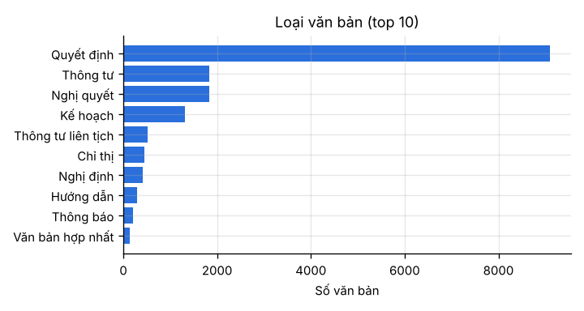
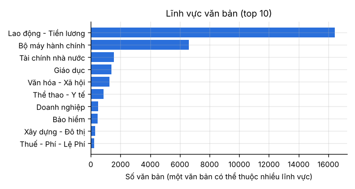
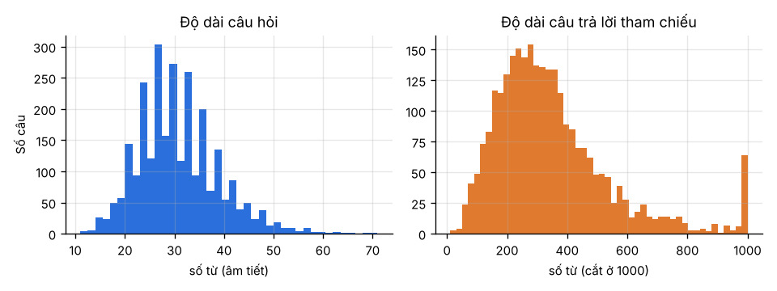
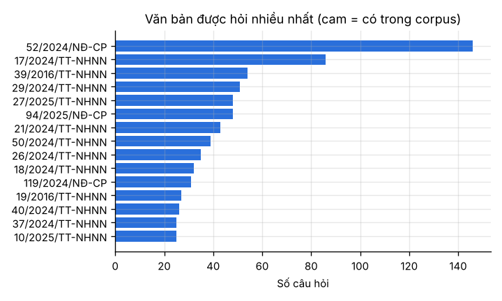
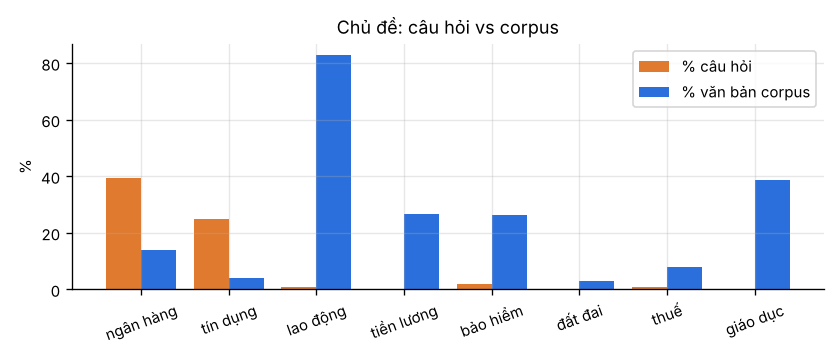
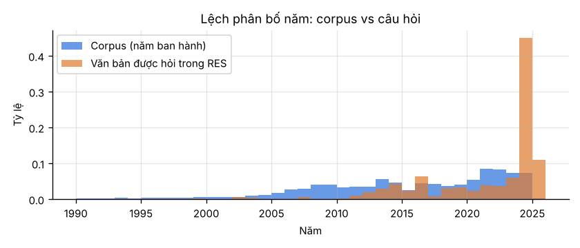

# Báo cáo: Cải tiến hệ thống RAG cho chatbot hỏi đáp pháp luật

> Mọi số liệu trong báo cáo được sinh bởi các script trong `scripts/` và chạy lại được (xem `README.md`).
> Bảng đầy đủ: `report/results_tables.md`. Câu trả lời từng câu: `results/predictions/`. Phân tích lỗi: `results/analysis/`.
> Phần GPU chạy trên Kaggle (GPU T4, miễn phí).

## 1. Giới thiệu
Mục tiêu của bài là cải thiện các chỉ số Cosine, Jaccard, Token Overlap, BLEU và ROUGE-L so với hệ thống RAG baseline được cung cấp
(`vietnamese-sbert` + FAISS + `Qwen1.5-1.8B`). Yêu cầu là dùng LLM dưới 4B tham số.

**Mọi cấu hình, kể cả baseline, được đánh giá trên cùng 200 cặp QA cố định** (`data/eval_set.csv`, seed 42). Đề bài yêu cầu tối thiểu 100 cặp.

**Kết quả chính.** Hệ thống cuối (cấu hình E) dùng: chunk theo Điều, tìm kiếm kết hợp BM25 + dense, xếp hạng lại bằng cross-encoder, `Qwen2.5-3B-Instruct`, prompt theo mẫu câu trả lời pháp lý và một ví dụ few-shot.
So với baseline gốc, nó tăng **ROUGE-L từ 0,096 lên 0,246 (+157%)**, **BLEU từ 0,117 lên 0,274 (+134%)**, **Jaccard từ 0,201 lên 0,306 (+52%)** và **Cosine từ 0,699 lên 0,764 (+9%)**.
Token Overlap của baseline gốc cao giả tạo vì output của nó có lẫn toàn bộ prompt (mục 3). So với baseline đã bỏ phần prompt lẫn vào, hệ thống cải tiến tốt hơn ở **cả 5 chỉ số**.

## 2. Khám phá dữ liệu
*Chi tiết và hình: `results/eda/eda_summary.md`.*

**Corpus.** 16.439 văn bản, khoảng 268 triệu ký tự sau khi làm sạch. Trung vị khoảng 9.000 ký tự mỗi văn bản, p95 khoảng 52.000.
- Loại văn bản: phần lớn là Quyết định (9.090), Thông tư (1.835), Nghị quyết (1.828) và Kế hoạch (1.317). Cơ quan ban hành chủ yếu là UBND/HĐND các tỉnh.
- Mỗi file kết thúc bằng 3 khối do crawler thêm vào: *THÔNG TIN THÊM* (tên, số hiệu, loại, **lĩnh vực**, nơi ban hành, ngày, tình trạng hiệu lực), *MỤC LỤC* và *VĂN BẢN LIÊN QUAN*.
- **100% văn bản thuộc lĩnh vực "Lao động – Tiền lương".** Khoảng 47% văn bản còn hiệu lực.
- Văn bản bị ngắt dòng cứng ngay giữa câu (ví dụ "VIỆT\n NAM").

 

**Bộ câu hỏi RES.** 2.745 cặp QA.
- Câu hỏi trung bình 31 từ. Câu trả lời tham chiếu **trung bình 351 từ** (p95 740 từ).
- 55% câu trả lời mở đầu bằng "Căn cứ…" và 92% có nhắc "Điều N". 17% câu hỏi ghi số hiệu văn bản ngay trong câu.
- 772 câu (28%) không có số hiệu văn bản ("Không trích xuất được").
- Văn bản được hỏi chủ yếu là của **NHNN (ngân hàng)** (1.256 câu) và Nghị định CP (444 câu).

 

**Độ phủ: corpus và câu hỏi lệch nhau.** Chỉ **8/314** văn bản được hỏi có trong corpus, ứng với **51/2.745 câu (1,9%)**.
Từ "ngân hàng" có trong 39% câu hỏi nhưng chỉ ở 15% văn bản, còn "lao động" có trong 0,9% câu hỏi nhưng ở 98,5% văn bản.
Văn bản được hỏi có trung vị năm 2024, trong khi corpus trải dài từ 1945.

→ Với khoảng 98% câu hỏi, không cách retrieval nào lấy được văn bản nguồn. Vì vậy tập eval được thiết kế gồm **cả 51 câu
có văn bản nguồn trong corpus (`covered`)** và 149 câu ngẫu nhiên (`not_covered`), và mọi kết quả được báo cáo riêng cho từng nhóm.

 

## 3. Baseline
Baseline gồm: chunk 2000/50 ký tự trên văn bản đã chuyển hết sang chữ thường → `keepitreal/vietnamese-sbert` → FAISS (L2) top-5 →
prompt 3 dòng → `Qwen/Qwen1.5-1.8B` (bản *base*, chưa tinh chỉnh để làm theo chỉ dẫn), greedy, `max_new_tokens=256`.

Hai điểm cần lưu ý khi tái lập:
1. Notebook gốc chỉ chạy `df.head(30)`. Chúng tôi chạy lại baseline với đúng cấu hình đó trên 200 câu của tập eval.
2. **Output của baseline có lẫn prompt.** `HuggingFacePipeline.generate` của LangChain mặc định `skip_prompt=False`,
   còn transformers mặc định `return_full_text=True`. Chúng tôi đã kiểm tra điều này trong mã nguồn `langchain_huggingface`.
   Vì vậy chuỗi được chấm điểm gồm cả prompt và 5 chunk ngữ cảnh: trung bình **2.369 từ**, so với 351 từ của câu tham chiếu.
   Token Overlap đo tỷ lệ từ của câu tham chiếu xuất hiện trong output, nên được lợi rất lớn từ output dài như vậy (0,768).
   Chúng tôi báo cáo cả hai phiên bản:
   - `baseline`: giữ nguyên hành vi gốc, dùng làm mốc chính thức;
   - `baseline_noecho`: chỉ chấm phần mô hình sinh ra. Phần này trung bình 79 từ và thường chỉ lặp lại câu hỏi.

## 4. Phương pháp cải tiến
| # | Thành phần | Baseline | Cải tiến | File |
|---|---|---|---|---|
| 1 | Tiền xử lý | lowercase, `\n`→space | chuẩn hóa NFC; nối dòng bị ngắt; **giữ hoa/thường**; tách metadata thành trường riêng; **bỏ MỤC LỤC / VĂN BẢN LIÊN QUAN** | `src/legal_text.py` |
| 2 | Chunking | ký tự 2000/50 | **theo Chương/Điều**, 1000/150, cắt ở biên câu/từ; gắn **header** (tên văn bản, số hiệu, Điều) vào mỗi chunk. Tổng cộng 384.612 chunk | `src/chunking.py` |
| 3 | Retrieval | dense sbert | **BM25** (âm tiết + bigram, tự cài bằng ma trận thưa) + dense **`bkai-foundation-models/vietnamese-bi-encoder`**, ghép bằng **RRF**; ưu tiên văn bản có số hiệu được ghi trong câu hỏi; tối đa 3 chunk mỗi văn bản | `src/retrieval.py`, `src/retriever.py` |
| 4 | Reranking | không có | cross-encoder **`BAAI/bge-reranker-v2-m3`**: lấy top-20 rồi giữ top-5 | `src/dense.py` |
| 5 | LLM | Qwen1.5-1.8B (base) | **Qwen2.5-3B-Instruct**, dùng chat template, greedy, `repetition_penalty=1.05`, `max_new_tokens=640` | `src/llm.py` |
| 6 | Prompt | 3 dòng chung chung | vai luật sư; bắt mở đầu bằng **"Căn cứ tại Điều … quy định:"** giống câu trả lời tham chiếu; nguồn được đánh số kèm header và tình trạng hiệu lực; cấm bịa số hiệu/Điều; nói rõ khi không tìm thấy | `src/prompts.py` |
| 7 | Few-shot | không có | 1 ví dụ hỏi–đáp cố định, chỉ lấy từ `fewshot_pool.csv` (không bao giờ lấy từ tập eval) | `src/fewshot.py` |
| 8 | Hậu xử lý | không có | bỏ prompt bị lặp, token đặc biệt và câu lặp | `src/postprocess.py` |

Lý do chọn:
- **(2)** Chunk nhỏ, có header giúp mỗi đoạn tự đứng được (retriever và LLM đều biết đoạn thuộc văn bản nào, Điều nào), và cho phép đưa nhiều nguồn hơn vào context của model 3B.
- **(3–4)** Văn bản pháp luật có rất nhiều từ khóa chính xác (số hiệu, thuật ngữ) nên BM25 mạnh, còn dense bắt được câu diễn đạt khác đi. Cross-encoder sắp xếp lại thứ hạng chính xác hơn.
- **(5–7)** Câu trả lời tham chiếu dài khoảng 350 từ và theo mẫu cố định. Các metric đo độ trùng từ, nên dạng và độ dài câu trả lời ảnh hưởng trực tiếp đến điểm.

## 5. Thí nghiệm
Môi trường: Kaggle, GPU T4, 200 câu. Mỗi cấu hình mất khoảng 9–13 giây/câu, tức khoảng 30–45 phút cho 200 câu. VRAM tối đa 4,5–7,4 GB (bảng cuối của `results_tables.md`).
Cosine luôn được tính bằng `keepitreal/vietnamese-sbert`, cùng embedding với baseline, để so sánh công bằng.

### 5.1 Retrieval (không dùng LLM)
`DocRecall@k`/`MRR` tính trên 51 câu covered, đo xem văn bản nguồn có nằm trong top-k không.
`CtxTokenRecall` là tỷ lệ từ của câu trả lời tham chiếu xuất hiện trong ngữ cảnh lấy về (tính trên cả 200 câu).

| Cấu hình (k = 5) | DocRecall@1 | DocRecall@5 | MRR | CtxTokenRecall | Ký tự ngữ cảnh |
|---|---|---|---|---|---|
| BM25, chunk baseline 2000 | 0,471 | 0,784 | 0,606 | **0,753** | 9.739 |
| BM25, chunk theo Điều | 0,471 | 0,784 | 0,606 | 0,633 | 4.059 |
| Dense bi-encoder, chunk theo Điều | 0,294 | 0,667 | 0,448 | 0,593 | 3.608 |
| Hybrid (BM25 + dense, RRF) | 0,471 | 0,843 | 0,622 | 0,653 | 3.841 |
| **Hybrid + rerank** | **0,608** | **0,863** | **0,727** | 0,655 | 3.960 |

- Trên corpus này, dense đứng riêng **kém hơn BM25**. Kết hợp hai cách thì tăng DocRecall@5 từ 0,784 lên 0,843.
  **Reranker** đưa văn bản đúng lên đầu nhiều hơn hẳn: DocRecall@1 từ 0,471 lên 0,608, MRR từ 0,606 lên 0,727.
- CtxTokenRecall cao nhất ở chunk 2000 chỉ vì ngữ cảnh dài gấp 2,5 lần.
  Khi lấy cùng khoảng 8k ký tự (BM25, chunk theo Điều, k = 10), DocRecall đạt 0,824 so với 0,784 (`retrieval_summary.csv`).

### 5.2 Kết quả chính (200 câu) – ablation, mỗi dòng thêm một thành phần
| Cấu hình | Cosine | Jaccard | Token Overlap | BLEU | ROUGE-L | Số từ TB |
|---|---|---|---|---|---|---|
| baseline (gốc, output lẫn prompt) | 0,6991 | 0,2012 | **0,7675** | 0,1173 | 0,0959 | 2.369 |
| baseline_noecho (chỉ phần sinh ra) | 0,5768 | 0,1510 | 0,1064 | 0,0426 | 0,1127 | 79 |
| A: + Qwen2.5-3B-Instruct + prompt mới (retrieval baseline) | 0,7259 | 0,2599 | 0,2946 | 0,2145 | 0,1999 | 208 |
| B: + chunk theo Điều + BM25 | 0,7316 | 0,2882 | 0,3382 | 0,2530 | 0,2257 | 235 |
| C: + hybrid (BM25 + dense) | 0,7363 | 0,2974 | 0,3483 | 0,2589 | 0,2293 | 237 |
| D: + rerank | 0,7517 | **0,3120** | 0,3692 | **0,2784** | 0,2424 | 248 |
| **E: + 1 ví dụ few-shot (hệ thống cuối)** | **0,7636** | 0,3063 | 0,3692 | 0,2740 | **0,2463** | 235 |
| *F: E + hỏi–đáp tương tự làm tài liệu tham khảo (xem 5.4)* | *0,7676* | *0,3692* | *0,4187* | *0,3276* | *0,3099* | *242* |

**Cải thiện của E so với baseline:**

| | Cosine | Jaccard | Token Overlap | BLEU | ROUGE-L |
|---|---|---|---|---|---|
| so với `baseline` | +0,065 (+9%) | +0,105 (+52%) | −0,398 (*) | +0,157 (+134%) | +0,150 (+157%) |
| so với `baseline_noecho` | +0,187 (+32%) | +0,155 (+103%) | +0,263 (+247%) | +0,231 (+543%) | +0,134 (+119%) |

(*) Token Overlap là chỉ số kiểu recall và không phạt độ dài. Output của baseline gốc có lẫn 2.369 từ prompt và ngữ cảnh, nên điểm này cao giả tạo.
BLEU (đo precision, có brevity penalty) và ROUGE-L (F1) phản ánh đúng hơn: cả hai đều tăng gấp khoảng 2,3–2,6 lần.

**Theo nhóm** (ROUGE-L / Cosine):

| Cấu hình | covered (51) | not_covered (149) |
|---|---|---|
| baseline | 0,130 / 0,740 | 0,084 / 0,685 |
| A | 0,215 / 0,751 | 0,195 / 0,717 |
| B | 0,320 / 0,811 | 0,193 / 0,705 |
| D | **0,350** / **0,843** | 0,206 / 0,721 |
| E | 0,329 / 0,834 | **0,218** / **0,740** |

**Nhận xét ablation:**
- **A: đổi LLM và prompt** mang lại bước nhảy lớn nhất (ROUGE-L từ 0,096 lên 0,200, BLEU tăng gấp đôi), dù retrieval vẫn y như baseline.
  Model instruct trả lời đúng trọng tâm, đủ dài và theo mẫu: 66–88% câu mở đầu bằng "Căn cứ…", còn baseline là 0%.
  Điều này khớp với nhận định ở EDA: các metric ưu tiên dạng và độ dài câu trả lời.
- **B: chunk theo Điều + BM25** tăng mạnh ở nhóm **covered** (ROUGE-L từ 0,215 lên 0,320) nhưng gần như không đổi ở not_covered (0,195 xuống 0,193).
  Đúng như dự đoán: retrieval tốt hơn chỉ giúp khi văn bản nguồn có trong corpus.
- **C: hybrid** cải thiện nhẹ trên toàn bộ. **D: rerank** cho điểm covered cao nhất (ROUGE-L 0,350, Cosine 0,843) và Jaccard/BLEU tổng cao nhất.
- **E: few-shot** cho Cosine và ROUGE-L tổng cao nhất, tốt nhất ở nhóm not_covered, và **ít bịa số hiệu nhất** (5.3).
  Đổi lại, điểm covered giảm nhẹ so với D. Vì vậy chúng tôi chọn E làm hệ thống cuối; D là phương án thay thế gần tương đương.

### 5.3 Phân tích lỗi
Thống kê từ `scripts/error_analysis.py`. "Bịa số hiệu" là trường hợp câu trả lời nhắc một số hiệu văn bản không xuất hiện ở đâu trong ngữ cảnh lấy về.

| Cấu hình | Bịa số hiệu (covered / not_covered) | Nói "không tìm thấy" | Mở đầu "Căn cứ…" |
|---|---|---|---|
| baseline_noecho | 4% / 9% | 2% / 7% | 0% / 0% |
| A | 31% / 35% | 18% / 39% | 88% / 66% |
| D | 6% / 17% | 6% / 11% | 100% / 97% |
| E | **2% / 11%** | 16% / 17% | 77% / 66% |

- Ở cấu hình A, ngữ cảnh lấy về thường không liên quan, nên model "căn cứ" vào văn bản nó nhớ hoặc tự bịa (31–35%).
  Khi retrieval tốt hơn (D, E), tỷ lệ này giảm còn 2–17%. Retrieval tốt không chỉ tăng điểm mà còn giảm bịa đặt.
- **Ví dụ tốt (covered, Q29):** câu hỏi về lịch nghỉ 30/4/2025. Hệ thống lấy đúng Thông báo 6150/TB-BLĐTBXH, trích đúng tên văn bản
  và đúng đợt nghỉ 5 ngày từ 30/4 đến 04/5/2025. Tuy vậy, model diễn giải sai ngày làm bù:
  văn bản quy định làm bù vào thứ Bảy 26/4, còn model lại coi 03/5 và 04/5 là "ngày làm việc bù".
  Đây là hạn chế về suy luận của model 3B.
- **Ví dụ điển hình của nhóm not_covered (Q53):** câu hỏi về quyền và nghĩa vụ của đối tượng thanh tra ngân hàng, đáp án nằm ở Điều 208 Luật Các tổ chức tín dụng 2024, không có trong corpus.
  Hệ thống lấy về Nghị định 88/2016/NĐ-CP về *ngân hàng giám sát* quỹ hưu trí, có từ khóa "ngân hàng giám sát" khớp, rồi trả lời dựa trên văn bản này.
  Câu trả lời bám đúng ngữ cảnh nhưng sai văn bản, hệ quả trực tiếp của việc corpus thiếu văn bản ngân hàng.
- **Baseline (noecho)** thường chỉ lặp lại câu hỏi và để lộ token "assistant", vì Qwen1.5-1.8B bản base không làm theo chỉ dẫn.

Chi tiết từng câu tốt/kém của mỗi cấu hình nằm trong `results/analysis/<cấu hình>.md`.

### 5.4 Ablation phụ F: dùng bộ hỏi–đáp làm tài liệu tham khảo (báo cáo riêng)
Cấu hình F thêm vào prompt 2 cặp hỏi–đáp tương tự nhất, lấy từ 2.545 cặp **không thuộc tập eval**.
Những câu gần như trùng lặp (Jaccard > 0,8) đã bị loại.

Kết quả: ROUGE-L tăng từ 0,246 lên 0,310, phần tăng gần như hoàn toàn ở nhóm not_covered (0,218 lên 0,310).
Tuy nhiên, đây là tận dụng dữ liệu hỏi–đáp chứ không phải RAG trên corpus. Câu trả lời cũng thường chép số hiệu văn bản từ các cặp hỏi–đáp đó (35% ở not_covered).
Vì vậy chúng tôi **không** dùng F làm kết quả chính. F chỉ cho thấy nếu corpus có đúng văn bản ngân hàng thì hệ thống có thể đạt mức nào.

## 6. Demo
Chạy `app/demo.py` (giao diện Gradio có link công khai, hoặc `--cli` để hỏi từ dòng lệnh), hoặc dùng `notebooks/demo.ipynb`.
Câu trả lời kèm danh sách nguồn: tên văn bản, Điều, tên file và đoạn trích.
Các câu hỏi mẫu được chọn trong lĩnh vực mà corpus có (lương cơ sở, nghỉ lễ tết, giấy phép lao động…).

## 7. Hạn chế
- **Corpus và câu hỏi lệch nhau** là giới hạn lớn nhất: chỉ khoảng 2% câu hỏi có văn bản nguồn trong corpus.
  Ở nhóm not_covered, phần điểm tăng chủ yếu đến từ việc câu trả lời đúng **dạng** hơn (đúng mẫu, đủ dài), chứ không đúng **nội dung** hơn.
- Các metric đo độ trùng từ nên ưu tiên câu trả lời dài và theo mẫu. Chúng không đo được tính đúng đắn pháp lý (xem ví dụ Q29).
- Model 3B đôi khi suy luận sai chi tiết (ngày, số liệu) dù đã lấy đúng văn bản.
- Đánh giá trên 200/2.745 câu do giới hạn GPU miễn phí. Tập eval cố định và cố tình chứa toàn bộ 51 câu covered,
  nên điểm trung bình "all" cao hơn một mẫu hoàn toàn ngẫu nhiên. Vì thế chúng tôi báo cáo riêng từng nhóm.

## 8. Kết luận
Trên cùng 200 câu, hệ thống cải tiến (E) vượt baseline gốc ở Cosine (+9%), Jaccard (+52%), BLEU (+134%) và ROUGE-L (+157%).
So với baseline đã bỏ phần prompt lẫn vào, nó tốt hơn ở cả 5 chỉ số.

Phần lớn mức tăng đến từ việc đổi sang LLM instruct và thiết kế prompt theo mẫu câu trả lời pháp lý.
Retrieval tốt hơn (chunk theo Điều, hybrid, rerank) tăng thêm mạnh ở những câu có văn bản nguồn trong corpus (ROUGE-L covered từ 0,215 lên 0,329–0,350) và giảm rõ việc bịa số hiệu văn bản (từ 31–35% xuống 2–11%).

Hướng phát triển: bổ sung văn bản ngân hàng (NHNN) và các văn bản năm 2024–2025 vào corpus, vì đây là phần lớn câu hỏi trong RES.

## Phụ lục: chạy lại
Xem `README.md`. Bước CPU mất khoảng 8 phút. Bước GPU dùng `notebooks/run_on_kaggle.ipynb` với chế độ *Save & Run All (Commit)* trên Kaggle (T4, miễn phí).
