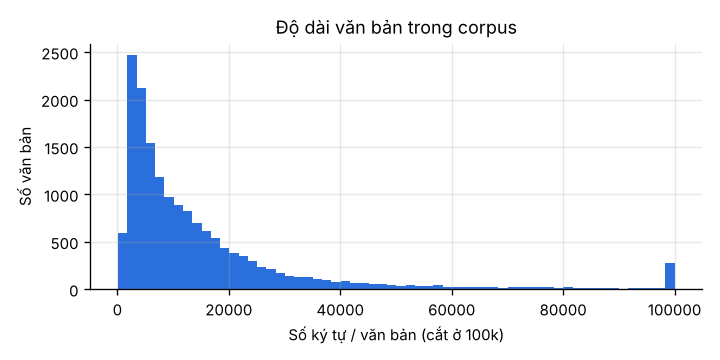
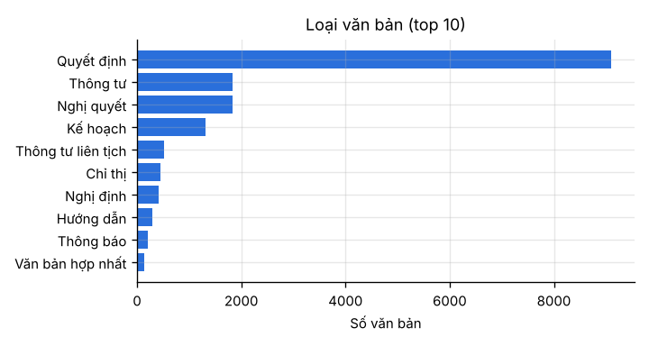
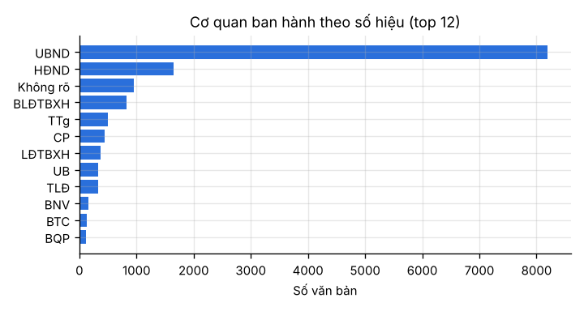
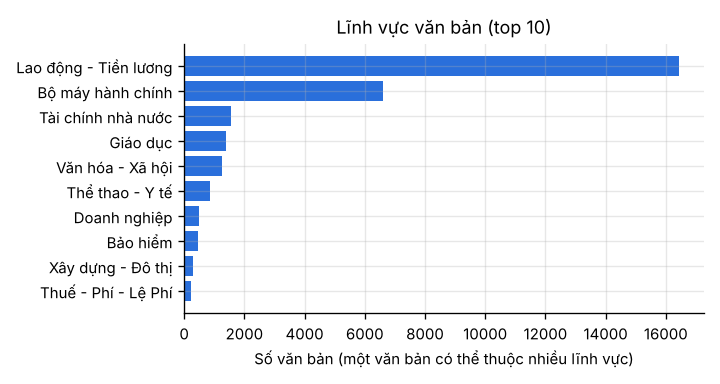
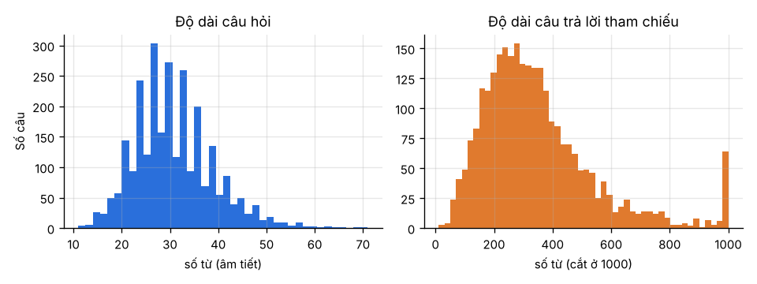
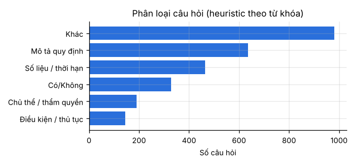
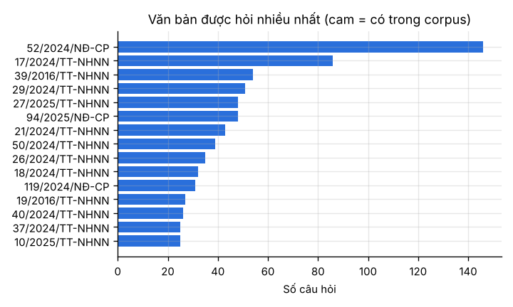
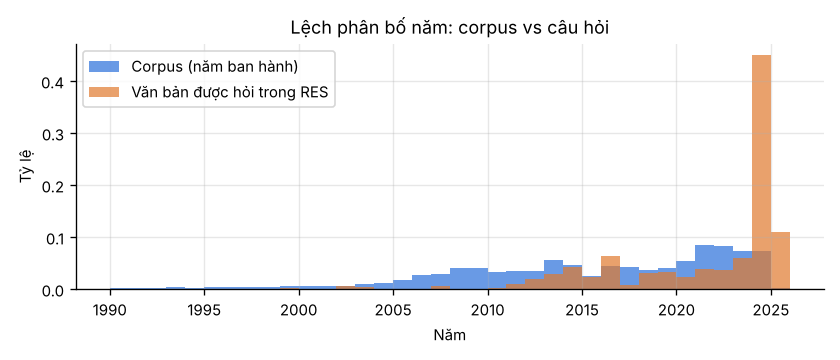
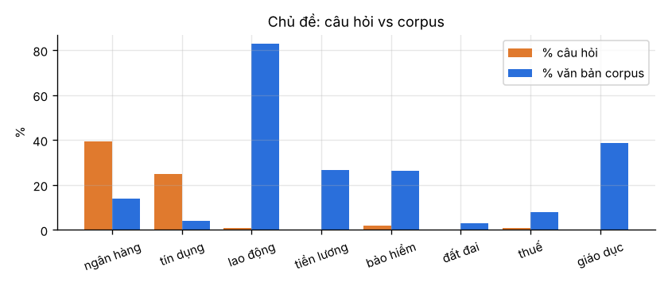

# Khám phá dữ liệu (EDA)

*Sinh tự động bởi `scripts/eda.py`. Hình nằm trong `results/eda/`.*

## Corpus văn bản pháp luật
- **16,439 văn bản**, tổng **268,249,709 ký tự** sau khi làm sạch. Năm ban hành từ 1945 đến 2025.
- Độ dài văn bản: trung vị 8,973 ký tự, p95 52,109, dài nhất 784,663.
- 12,573 văn bản có cấu trúc "Điều …", nên có thể chunk theo Điều.
- Ước lượng số chunk: khoảng 137,612 với chunk 2000 ký tự (baseline), khoảng 315,559 với chunk 1000/150.
- Loại văn bản nhiều nhất: Quyết định (9090), Thông tư (1835), Nghị quyết (1828), Kế hoạch (1317), Thông tư liên tịch (524), Chỉ thị (448).
- Cơ quan ban hành nhiều nhất: UBND (8191), HĐND (1646), Không rõ (951), BLĐTBXH (827), TTg (498), CP (436).
- **Lĩnh vực** (từ khối metadata "THÔNG TIN THÊM" ở cuối mỗi file): Lao động - Tiền lương (16439), Bộ máy hành chính (6589), Tài chính nhà nước (1553), Giáo dục (1398), Văn hóa - Xã hội (1256), Thể thao - Y tế (859).
- Tình trạng hiệu lực: Còn hiệu lực (7796), Hết hiệu lực (5421), Không còn phù hợp (1675), Không xác định (1517), Còn hiệu lực đến (21), Chưa có hiệu lực (7).
- Mỗi file kết thúc bằng 3 khối do crawler thêm vào: "THÔNG TIN THÊM" (metadata), "MỤC LỤC" và "VĂN BẢN LIÊN QUAN".
  Khi tiền xử lý, metadata được tách ra làm trường riêng, còn hai khối sau bị loại vì là nhiễu: mục lục lặp lại nội dung, còn danh sách liên kết thì không liên quan.

   

## Bộ câu hỏi RES
- **2,745 cặp QA**, trích dẫn 314 văn bản khác nhau; **772 câu (28%) không có số hiệu** ("Không trích xuất được"). Chỉ 132 dòng có nhãn đúng/sai.
- Câu hỏi: trung bình 30.6 từ. Câu trả lời: trung bình **350.9 từ** (1,619.3 ký tự), p95 740.0 từ.
- 55% câu trả lời bắt đầu bằng "Căn cứ…", và 92% có nhắc "Điều N".
  Mẫu câu này nên dùng cho prompt.
- 17% câu hỏi có ghi số hiệu văn bản ngay trong câu, nên có thể dùng regex để lọc hoặc ưu tiên văn bản đó khi retrieve.
- Loại câu hỏi (heuristic): Khác 982, Mô tả quy định 636, Số liệu / thời hạn 464, Có/Không 329, Chủ thể / thẩm quyền 190, Điều kiện / thủ tục 144.
- Cơ quan của văn bản được hỏi: NHNN (1256), Khác (792), CP (444), BTC (84), TT (58), BLĐTBXH (22).
  Phần lớn là văn bản **ngân hàng (NHNN)** và Nghị định của Chính phủ.

  

## ⚠️ Độ phủ: corpus không khớp với câu hỏi
- Chỉ **8/314** văn bản được hỏi có trong corpus, ứng với **51/2745** câu hỏi (1.9%).
- Các văn bản có trong corpus: 6150/TB-BLĐTBXH (21 câu), 14/2022/TT-NHNN (20 câu), 5015/TB-LĐTBXH (4 câu), 595/QĐ-BHXH (2 câu), 1570/TB-BLĐTBXH (1 câu), 07/VBHN-VPQH (1 câu), 07/2024/TT-BNV (1 câu), 73/2024/NĐ-CP (1 câu).
  Lưu ý: số hiệu địa phương (vd `…/QĐ-UBND`) có thể trùng giữa các tỉnh. Xem `covered_docs_matches.json`.
- Năm của văn bản được hỏi có trung vị 2024, nghiêng hẳn về 2024–2025, trong khi corpus trải dài từ 1945.
- Chủ đề lệch nhau: "ngân hàng" xuất hiện trong 39.3% câu hỏi nhưng chỉ 14.1% văn bản;
  ngược lại, "lao động" xuất hiện trong 0.9% câu hỏi nhưng có mặt trong 82.8% văn bản.
  Nói cách khác, corpus chủ yếu là văn bản về **lao động, tiền lương, việc làm**, còn câu hỏi chủ yếu về **ngân hàng**.

 

**Hệ quả cho thiết kế:**
1. Retrieval chỉ có thể tìm đúng văn bản nguồn cho khoảng 2% câu hỏi. Với phần còn lại, nó chỉ tìm được văn bản *liên quan về chủ đề*.
   Vì vậy kết quả được báo cáo riêng cho hai nhóm `covered` và `not_covered`.
2. Metric đo bằng độ trùng từ với câu trả lời tham chiếu dài khoảng 351 từ, nên **dạng và độ dài** câu trả lời
   (mở đầu "Căn cứ…", trích Điều, đủ dài để không bị phạt brevity penalty) ảnh hưởng rất lớn tới điểm.
3. LLM phải được dặn **không bịa số hiệu hay điều luật** khi ngữ cảnh không chứa văn bản được hỏi.
